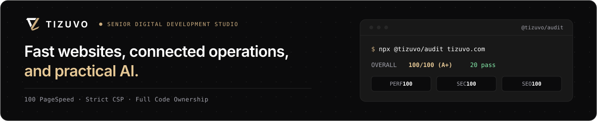

  <a href="https://tizuvo.com">
    <picture>
      <source media="(prefers-color-scheme: dark)" srcset="./assets/banner-dark.svg" />
      <source media="(prefers-color-scheme: light)" srcset="./assets/banner-light.svg" />
      
    </picture>
  </a>

  <a href="https://tizuvo.com"><strong>tizuvo.com</strong></a> ·
  <a href="https://tizuvo.com/audit">Free 3s Audit</a> ·
  <a href="https://starter.tizuvo.com">Live Starter Demo</a> ·
  <a href="https://tizuvo.com/book">Book a 30-Min Call</a> ·
  <a href="mailto:hello@tizuvo.com">hello@tizuvo.com</a>

---

### Open Source

| Project | What it does | Try it |
|---|---|---|
| [**site-audit-cli**](https://github.com/tizuvo/site-audit-cli) | Zero-dependency Node.js CLI for 18 live performance, TLS/security, and SEO checks | `npx @tizuvo/audit tizuvo.com` · [npm](https://www.npmjs.com/package/@tizuvo/audit) |
| [**zero-bloat-starter**](https://github.com/tizuvo/zero-bloat-starter) | 100/100 static & edge starter kit with strict CSP and `<4 KB` JS | [Live demo](https://starter.tizuvo.com) |
| [**ai-ops-blueprints**](https://github.com/tizuvo/ai-ops-blueprints) | 3 importable n8n + human-in-the-loop AI workflows with spend caps | [View blueprints](https://github.com/tizuvo/ai-ops-blueprints) |

### What We Build

Senior developers partnering with founders and product teams across **Web Development**, **Workflow Automation**, **AI Implementations**, **Technical SEO**, **Website Care & Security**, and **Monthly Retainers** — with zero vendor lock-in.

`Next.js` · `React` · `WordPress` · `Shopify` · `Cloudflare` · `n8n` · `OpenAI` · `Stripe` · `GitHub`

---

  Building, automating, or fixing something?
  <a href="https://tizuvo.com/book">Book a free 30-minute call</a> ·
  <a href="https://tizuvo.com/audit">Run the instant audit</a> ·
  <a href="mailto:hello@tizuvo.com">hello@tizuvo.com</a>

